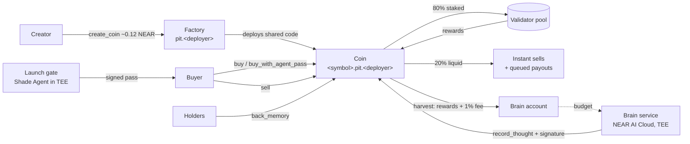
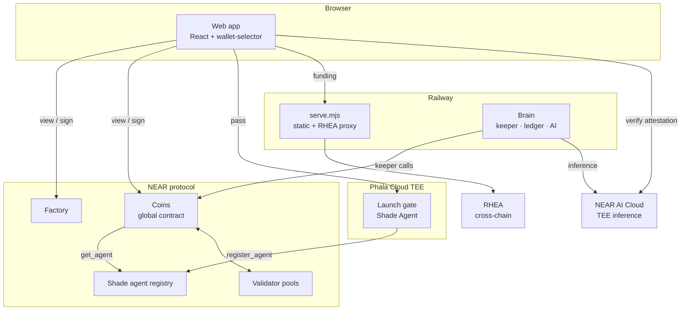

# The Pit

**A NEAR memecoin launchpad where every coin is fully backed, its reserve is
staked, and the yield feeds the coin's own AI.**


> **Status.** The hackathon build runs on **NEAR testnet**. Mainnet launch is
> planned **after an independent third-party security audit**. The contracts are
> internally audited, every finding is fixed and tested, and they are ready to
> deploy; see [Status and roadmap](#status-and-roadmap).

---

## Contents

- [Why The Pit](#why-the-pit)
- [How it works](#how-it-works)
- [Economics](#economics)
- [Architecture](#architecture)
- [Built on NEAR](#built-on-near)
- [Repository layout](#repository-layout)
- [Quick start](#quick-start)
- [Testing](#testing)
- [Deployment](#deployment)
- [Security](#security)
- [Status and roadmap](#status-and-roadmap)
- [Documentation](#documentation)

---

## Why The Pit

Most memecoin launchpads share three problems:

- **Unbacked prices.** When liquidity leaves, holders are left with nothing to sell into.
- **Sniped launches.** Bots buy the first block before people can react.
- **No reason to hold.** The token does nothing after launch.

The Pit changes each one:

| Problem | The Pit |
|---|---|
| Unbacked prices | Every coin trades on its own **bonding curve**. All NEAR paid in stays in the coin as **principal**, which the curve owes back to holders. Selling the whole supply can never pay out more than the reserve holds. |
| Idle reserves | Most of the principal is **staked with NEAR validators**; a liquid buffer pays sellers immediately. |
| Sniped launches | Creators can add an **early-access window**. Buying then needs a short-lived, **wallet-bound pass** from a gate running as a **NEAR Shade Agent**, with per-wallet caps and a wallet balance floor. |
| Nothing to do | Staking rewards and a 1% trading fee are the coin's **only income**. They feed its **brain**: an AI that posts as the coin, grows into larger models as its reserve grows, and signs every thought in NEAR AI's TEE, with the signature **verified on-chain** (*Proof of Thought*). Holders shape its personality by **locking tokens behind memories**. |

Anyone can launch a coin in **one transaction for ~0.12 NEAR**. Every coin runs
the same immutable code, and the launchpad has **no admin keys**.

## How it works



1. **Launch.** The creator picks a name, symbol and image (stored on-chain, ≤ 16 KB),
   an optional early-access window, and a creator cut of 0–50% of the brain's income.
   The factory creates `<symbol>.<factory>` running the shared, hash-pinned code.
2. **Early access** (optional). For each epoch, a buyer gets a pass: their wallet
   must exist and hold the minimum balance, then solve a challenge and a small proof
   of work. The pass binds buyer, sale, epoch, token cap, expiry and a one-use nonce.
   The contract checks the signature, asks the Shade agent registry whether the
   signing agent is valid, and refunds the buyer if anything fails.
3. **Trading.** Buys mint on the curve; sells burn and are paid from the liquid
   buffer at once, or queued at a fixed price until staked NEAR returns.
4. **Keeping.** A permissionless keeper calls `rebalance` (one pool action at a
   time, under a lock only callbacks release), `process_queue` and `harvest`.
5. **Thinking.** The brain service turns confirmed harvests into an inference
   budget. It writes each thought on a model matching the coin's tier, and records
   the NEAR AI signature with `record_thought`, which re-verifies it on-chain.
   Anyone can press *Verify* in the app: the browser re-checks the signature, the
   response hash and NEAR AI's **live** TEE attestation for the signing key.
6. **Memory.** Holders propose memories and lock tokens behind them. A memory
   joins the canon the brain reads once its conviction (tokens × time) passes a
   threshold. Tokens unlock any time.

## Economics

| Parameter | Value |
|---|---|
| Curve | Constant product on virtual reserves: `(3,000 NEAR + principal) × (1,073,000,000 − supply) = k` |
| Trading fee | 1% of each buy and sell, to the brain (max 5%, fixed per coin) |
| Liquid buffer | 20% of principal kept liquid; the rest staked |
| Brain income | Staking rewards + fees; creator takes 0–50% (fixed at launch) |
| Brain tiers | Larva → Juvenile (1,000 NEAR principal) → Adult (10,000) → Ascended (100,000); larger models at higher tiers |
| Launch cost | ~0.12 NEAR (0.1 coin storage + 0.02 registry record), plus 0.01 NEAR per KB of image |
| User storage | Refundable sell-ticket deposit (0.004 NEAR); early-access pass record (0.002 NEAR) |

Solvency invariant: `liquid + staked + unstaking ≥ principal + queued payouts`,
checked after every operation in a 10,000-operation randomized simulation.

## Architecture



| Component | Path | Role |
|---|---|---|
| Coin contract | [`pit/contracts/pit`](pit/contracts/README.md) | NEP-141 token, curve, staked reserve, payouts, gate checks, mind |
| Factory | [`pit/contracts/factory`](pit/contracts/README.md) | Publishes the coin code once; creates coins; refunds failed launches |
| Brain | [`pit/brain`](pit/brain/README.md) | Keeper, budget ledger, AI thoughts with on-chain proofs, public feed API |
| Launch gate | [`pit/gate-agent`](pit/gate-agent/README.md) | Early-access passes; Shade Agent identity in a TEE |
| Web app | [`webapp`](webapp/README.md) | Launch, trade, verify thoughts, portfolio, payouts, cross-chain funding |
| Scripts | [`pit/scripts`](pit/scripts/README.md) | Build, deploy (with mainnet guards), artifact pinning, rehearsal |

Trust boundaries are described in [docs/architecture.md](docs/architecture.md).

## Built on NEAR

| NEAR technology | How The Pit uses it |
|---|---|
| **Global contracts** | The coin code is published once and pinned by hash; each launch deploys by reference, so a coin costs ~0.12 NEAR instead of ~3.5 |
| **Shade Agents** | The launch gate runs in a TEE; coins accept passes only from agents the registry reports as valid |
| **NEAR AI Cloud** | TEE inference; Ed25519 response signatures verified on-chain by `record_thought`, attestation re-checked in the browser |
| **Validator staking pools** | Coin reserves earn staking rewards via `deposit_and_stake` / `unstake` / `withdraw` |
| **NEP-141 / NEP-145 / NEP-148** | Every coin is a standard fungible token, usable by wallets and DEXes |
| **Promises and callbacks** | Every payout, harvest and refund is confirmed by callback; nothing is resent on a timeout |
| **RHEA** | Cross-chain funding of a NEAR wallet from Ethereum, Base and Arbitrum assets |

## Repository layout

```text
.
├── pit/
│   ├── contracts/
│   │   ├── pit/            coin contract (modules: trading, payouts, staking, mind, views, token)
│   │   ├── factory/        launchpad factory
│   │   └── mock-*/         test-only pool and agent registry
│   ├── brain/              keeper + budget ledger + AI service (Node)
│   ├── gate-agent/         launch gate as a Shade Agent (Node)
│   ├── scripts/            build, deploy, artifacts, readiness, rehearsal
│   └── web/                zero-dependency brain meter page
├── webapp/                 web app (React/Vite) + static server + RHEA proxy
├── docs/                   submission kit, deployment guides, audits
├── legacy/human/           earlier $HUMAN prototype (not part of The Pit)
├── package.json            workspace scripts (build, test)
└── rust-toolchain.toml     pinned Rust 1.97.1
```

## Quick start

**Prerequisites:** Node 20.11+, Rust (installed from `rust-toolchain.toml`) with
the `wasm32-unknown-unknown` target, and [`cargo-near`](https://github.com/near/cargo-near).

```bash
git clone https://github.com/drained69/thepit.git && cd thepit
npm ci --prefix webapp && npm ci --prefix pit/brain && npm ci --prefix pit/gate-agent && npm ci --prefix pit/scripts
```

Run the web app in preview mode (sample data, no chain needed):

```bash
npm --prefix webapp run dev
```

Build everything and run all tests:

```bash
npm run build
```

```bash
npm test
```

To run against real contracts, follow the [testnet runbook](docs/deployment/testnet.md).

## Testing

| Suite | Command | Count |
|---|---|---|
| Coin contract (host) | `npm run test:contracts` | 93 |
| Factory contract (host) | (included above) | 10 |
| Sandbox end-to-end on a local NEAR node | `cargo test --features integration --test integration` in each contract | 5 coin + 1 factory |
| Brain · gate · scripts · web | `npm run test:js` | 21 · 24 · 7 · 28 |

Highlights:

- **Invariant simulation** (`pit/contracts/pit/tests/fuzz.rs`): 5 seeds × 2,000
  random buys, sells, keeper rounds, pool failures, rewards, harvests and memory
  votes. Solvency, the curve bound, token conservation, escrow and queue
  accounting are asserted after every operation.
- **Byte-level ABI tests**: the deploy script's and the brain's Borsh encoders
  are decoded by the contract's own types.
- **Full keeper cycle on a local node** (`pit/scripts/sandbox-e2e.mjs`): deploy
  with `--lock`, buy, stake, sell, unstake, withdraw and harvest through every callback.

## Deployment

| Network | Guide | Cost |
|---|---|---|
| **Testnet** (hackathon) | [docs/deployment/testnet.md](docs/deployment/testnet.md) | ≈ 39 testnet NEAR (free) for the launchpad with test-only mocks |
| **Mainnet** (after audit) | [docs/deployment/mainnet.md](docs/deployment/mainnet.md) | ≈ 36.27 NEAR: 32.18 burned to publish the shared coin code, 3.04 factory storage, 1.05 keeper and brain |

`deploy.mjs` refuses unsafe mainnet configurations: mock pools or registries, a
dev-key gate, a missing `--lock`, unpinned artifact hashes, or an existing target.
It deletes the factory's keys only after confirming the code was published with
the pinned hash.

## Security

- **No admin.** After deployment the factory has no access keys, and coins never
  have any. Pools, curve, fees, schedule and gate are fixed at init.
- **Confirmed transfers.** Payouts, harvests and refunds stay locked until a
  callback confirms success. Recovery after a confirmed failure is owner-only.
- **Reviews.** Internal audits are in [docs/audits](docs/audits/). The latest,
  [MAINNET_READINESS_2026_11_09](docs/audits/MAINNET_READINESS_2026_11_09.md),
  includes proofs of concept, a fix log and local-node rehearsals.
- **Known limits**, stated plainly:
  - The early-access gate puts a capital cost on each bot wallet. It does not prove unique personhood.
  - On testnet the pool and registry are mocks, and the gate runs with a local key rather than in a TEE.
  - Attestation checks confirm key binding in NEAR AI's report; full Intel TDX quote verification is out of scope.
  - **No external audit yet**: mainnet waits for one.

Report vulnerabilities privately to the repository owner rather than in public issues.

## Status and roadmap

| Milestone | State |
|---|---|
| Contracts, brain, gate, web app | ✅ Complete; all suites pass |
| Internal security review with fixes | ✅ [Report](docs/audits/MAINNET_READINESS_2026_11_09.md) |
| Local-node deploy and keeper rehearsal | ✅ |
| Testnet deployment (hackathon) | ▶︎ [Runbook](docs/deployment/testnet.md) |
| Independent third-party audit | ⏳ Required before mainnet |
| Mainnet: real validator pool, production Shade gate in a TEE | ⏳ After the audit |
| Personhood credential in the gate (optional) | 💡 Future |

## Documentation

- [Documentation index](docs/README.md)
- [Hackathon submission kit](docs/SUBMISSION.md)
- [Contract mechanics and interfaces](pit/README.md)
- [RHEA integration](pit/RHEA_INTEGRATION.md)

## License

[MIT](LICENSE)
